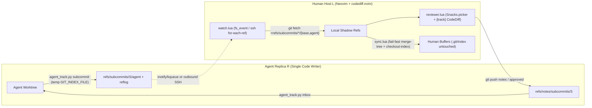

# agent-track

Single-writer subcommit streaming, causal `codediff.nvim` review, and fail-fast non-intrusive working-tree sync between a human's Neovim (`L`) and any local or remote SSH agent replica (`R`) — built directly on Git 2.38+ plumbing with **zero intermediary server** (no GitLab/GitHub round-trip), **zero `.git/index` or `HEAD` mutation**, and **zero conflict markers written to `L`**.

---

## 1. Topology & Single-Writer Streaming Architecture



- **Local Mode (`:AgentTrack attach /path/to/R`)**: watches `<R-git-common-dir>/logs/refs/subcommits` recursively via `vim.uv.new_fs_event` (+ `poll_ms` fallback) across all `<session>` names and runs debounced async wildcard `git fetch`.
- **Outbound SSH Mode (`:AgentTrack attach user@devbox:/path/to/R` or `ssh://...`)**: `L` opens one multiplexed outbound `ssh` stream (`ControlMaster=auto`) running a lightweight in-remote `git for-each-ref` loop over `refs/subcommits/*/agent` and `refs/notes/subcommits/*` (works across standard repos, Git worktrees, bare repos, packed-refs, and any `<session>` name — even sessions created after `attach`!) with `ssh_poll_ms = 0` and fast-failure circuit-breaker backoff. `R` never needs inbound network access, credentials, or a central Git server back to `L`.

---

## 2. Git Ref, Note & Trailer Protocol

All session state lives under `<ref_prefix>/<session>/` (default `refs/subcommits/default/`) plus `refs/notes/<notes_prefix>/<session>` (`refs/notes/subcommits/default`):

| Ref / Note | Object | Purpose |
| :--- | :--- | :--- |
| `base` | Commit | Common ancestor SHA at `init-agent`. |
| `agent` | Commit | Agent's latest shadow subcommit tip (linear chain `base..agent`, reflog enabled). |
| `synced` | Commit | Exact agent tree merged into `L` so far (`base` initially; synthetic `commit-tree` with `Applied-Subcommits` trailer on cherry sync). |
| `approved` | Commit | Optional prefix-approval watermark (`1..k`). |
| `undo` | Commit | Lossless `commit-tree` stack of pre-sync `L` working trees (`Restores-Synced`, `Restores-Applied` trailers). |
| `state` | Blob | JSON `{ remote, session, applied_ids }`. |
| `refs/notes/subcommits/<S>` | Notes | Per-commit JSON `{"status":"approved"\|"rejected"\|"pending","comment":"...","subcommit_id":"...","patch_id":"<git patch-id --stable>","updated_at":<unix>}`. |

**Subcommit Commit Trailers**
- `Subcommit-Id: sc-YYYYMMDDHHMMSS-xxxx` — stable logical identity across history rewrites.
- `Touch-Order: path/a.lua, path/b.lua` — causal reading sequence stepped by `]f` / `[f`.
- Approvals can carry a comment (`<leader>tc`); the agent reads it in `agent_track.py inbox` as a non-blocking follow-up.

**Effective Review Status Precedence (`list()`)**
1. Direct note on `<sha>` (`review_via = "note"`).
2. Orphan note matching `Subcommit-Id` across rewrite (`review_via = "rewrite"`): if `patch_id` matches `git patch-id --stable`, preserves status; if `patch_id` changed on a previously `approved` subcommit, marks `"stale"`.
3. Ancestor of `refs/subcommits/<S>/approved` (`review_via = "prefix"`).
4. Otherwise `"pending"`.

**Git Safety Invariants**: Every commit/note/ref write passes `-c commit.gpgsign=false` (prevents headless SSH/GPG signer hangs, including on `git notes add`), fallback `-c user.name=agent-track -c user.email=agent-track@local` when unset, and `-c core.logAllRefUpdates=always`.

---

## 3. Fail-Fast Non-Intrusive Sync & Undo

1. **`.git/index` & `HEAD` Invariance**: `apply()` and `undo()` copy `.git/index` to a temporary `GIT_INDEX_FILE`, stage modified tracked files + only untracked paths touched by `diff-tree(base, target)`, run `git merge-tree --write-tree -z` in memory, push pre-sync `L` onto `refs/subcommits/<S>/undo`, and materialize only changed files via `git checkout-index -f` + `silent! checktime`. Staged index entries, `HEAD`, and unrelated untracked files remain byte-for-byte untouched.
2. **Non-Prefix Cherry Sync (`:AgentTrack sync approved`)**: When subcommits `#1` and `#3` are approved while `#2` is rejected, `sync.lua` folds each unapplied approved `S_i` onto `synced` via `git merge-tree --write-tree --merge-base=parent(S_i) <acc_tree> <S_i>`, then 3-way merges the resulting tree into `L`.
3. **Fail-Fast Clean Merge Guarantee**: `list(s, { preview_conflicts = true })` reports overlapping local edits as `would_conflict` (the review UI does not request it: subcommits are synced in order, not merged ahead one by one). If `apply()` detects a conflict (`not merged.clean`), it **aborts before writing anything to disk or touching `undo`**, returning `{ ok = false, conflict = true, conflicts = ... }` — never polluting `L` with `<<<<<<<` conflict markers. In this single-writer design, the human steers direction via `approve` / `reject` notes and harness prompts while keeping `L` clean.

---

## 4. Configuration (`setup(opts)`)

```lua
require("agent-track").setup({
  ref_prefix = "refs/subcommits",
  notes_prefix = "subcommits",
  default_session = "default",
  git_cmd = { "git" },
  ssh_cmd = {
    "ssh", "-o", "BatchMode=yes",
    "-o", "ControlMaster=auto", "-o", "ControlPath=/tmp/at-ssh-%C",
    "-o", "ControlPersist=600", "-o", "ServerAliveInterval=30",
  },
  watch = {
    enabled = true,
    mode = "auto",          -- "auto" | "local" | "ssh" | "poll"
    poll_ms = 5000,         -- fallback poll interval for local/poll modes
    ssh_poll_ms = 0,        -- 0 disables periodic git fetch polling over SSH
    debounce_ms = 150,
    reconnect_ms = 3000,
    max_retries = 3,        -- fast-failure circuit breaker before detaching SSH watcher
    remote_tail_cmd = nil,  -- optional custom argv override for SSH tail
  },
  auto_save_before_sync = true,
  auto_sync_approved = false,
  notify_on_arrival = true,
  reviewer = {
    tab_prefix = "[track]",
    reuse_tab = true,
    open_on_attach = true,                       -- :AgentTrack attach opens the first pending subcommit
    pane = { enabled = true, position = "bottom", max_height = 5 }, -- full-width bottom list; "explorer" = under the file tree
    keymaps = {                                  -- each value: one lhs or a list of lhs
      next_subcommit = { "<leader>tj", "]c" },
      prev_subcommit = { "<leader>tk", "[c" },
      next_touch_file = "]f",
      prev_touch_file = "[f",
      approve = "<leader>ta",
      approve_comment = "<leader>tc",
      approve_prefix = "<leader>tA",
      reject = "<leader>tx",
      sync = "<leader>ts",
      panel = "<leader>tp",
    },
  },
  statusline = { enabled = true, format = nil },
  hooks = { on_updated = nil, on_synced = nil, on_reviewed = nil }, -- + User autocmds AgentTrack{Updated,Synced,Reviewed}
})
```

---

## 5. Commands & Keymaps

### `:AgentTrack` Subcommands & Global Keymaps (`lua/plugins/agent-track.lua`)

| Command | Global Key | Action |
| :--- | :--- | :--- |
| `:AgentTrack attach <remote> [session]` | — | Attach local path or SSH URL (`user@host:/repo`), wildcard-fetch sessions, start watcher, then open the first pending subcommit's `[track]` diff (`reviewer.open_on_attach`) |
| `:AgentTrack session [name]` | — | List discovered sessions (`*` = active) or switch active `<session>` |
| `:AgentTrack detach [session]` | — | Stop background watcher for session |
| `:AgentTrack fetch [session]` | `<leader>atf` | Wildcard-fetch latest `agent`, `base`, and `notes` refs (auto-switches if active session is empty) |
| `:AgentTrack review [session]` | `<leader>atr` | Open `Snacks.picker` subcommit review deck (`vim.ui.select` fallback) |
| `:AgentTrack list` | — | Print every session in this repo with `✓` approved / `✗` rejected / `·` pending counts, then pick one (`vim.ui.select`) to open its review deck |
| `:AgentTrack open [idx\|sha\|id]` | `<leader>ato` | Open subcommit in single reused `[track]` `:CodeDiff` tab |
| `:AgentTrack approve [idx\|sha] [--prefix]` | — | Approve subcommit (or `1..k` watermark with `--prefix`) & push notes |
| `:AgentTrack reject <idx\|sha> <reason>` | — | Reject subcommit with comment & push notes to `R` |
| `:AgentTrack sync [approved\|all\|idx\|sha]` | `<leader>ats` | Fail-fast non-intrusive 3-way merge into working tree |
| `:AgentTrack undo [session]` | `<leader>atu` | Restore exact pre-sync working tree from `undo` stack |
| `:AgentTrack status [session]` | `<leader>ati` | Show counts, sync tip, and watcher mode |
| `:AgentTrack clean [session]` | — | Detach watcher and delete all session refs & notes |

### Review Panel (`Snacks.picker`) & `[track]` `:CodeDiff` Tab Keys

| Context | Key | Action |
| :--- | :--- | :--- |
| **Picker (`<leader>atr`)** | `<CR>` | Open selected subcommit in `[track]` `:CodeDiff <parent> <sha>` tab |
| | `a` / `C` / `A` | Approve / Approve with a comment (prompt) / Prefix-approve `1..idx` |
| | `x` / `c` | Reject (prompt reason) / Clear to pending |
| | `s` / `S` / `u` / `r` | Sync approved / Sync prefix up to selected / Undo last sync / Fetch & refresh |
| | `<c-q>` | Send the (selected or all) subcommits to quickfix: `<CR>`, `:cc`, `:cnext`/`:cprev` there open that subcommit's `[track]` diff |
| **`[track]` Diff Tab** | `<leader>tj` / `<leader>tk` (also `]c` / `[c`) | Next / Previous chronological subcommit (reuses single `[track]` tab) |
| | `]f` / `[f` | Next / Previous file in causal `Touch-Order`, selected inside the explorer tree (the tab opens at `Touch-Order` #1) |
| | `<leader>ta` / `<leader>tc` | Approve / Approve with a comment (prompt) — both advance to the next pending subcommit |
| | `<leader>tA` / `<leader>tx` | Prefix-approve `1..k` / Reject with a reason (prompt), then open the next pending subcommit |
| | `<leader>ts` / `<leader>tp` | Sync / Open review panel |
| **Subcommit pane** | `<CR>` / `o` | Open the subcommit under the cursor |
| | `a` / `C` / `x` | Approve / Approve with a comment / Reject the row under the cursor |
| | `p` | Float with the full message (subject, why/body, trailers, review comment); closes on cursor move |
| | `R` | Re-list (also automatic on `AgentTrack{Updated,Reviewed,Synced}`) |

### Subcommit Pane

The `[track]` tab shows every subcommit of the session in a full-width bottom split, like `:botright copen` (explorer-style header and selection colors), so the whole chain stays visible while reading one slice:

```text
 Changes (3)                            │ <old side>           │ <new side>
└ config.nvim/plugins/agent-track/lua/  │                      │
  ├ pane.lua                         A  │                      │
────────────────────────────────────────┴──────────────────────┴──────────────
 Subcommits (8)                                                         ✓2 ·6
 ✓ 1 805c14b feat(codediff): show the explorer as a directory tree by default
 ✓ 2 8cf23e5 feat(agent-track): add <leader>tj/tk jumps and <leader>tc comment+approve
 · 3 e329445 feat(agent-track): dock a subcommit pane ...   <- open subcommit (selection color)
```

Each row is the review badge (`✓` approved, `✗` rejected, `~` stale, `·` pending), the index, the short SHA (when ≥ 56 columns wide) and the subject (truncated only if it does not fit); `p` shows the full message. The pane stays at the bottom across `toggle_explorer`, keeps a manual resize (up to `max_height` rows by content), and stays closed once you `:q` it in that tab. `position = "explorer"` instead docks it under the file tree (same column, hides and returns with the explorer). It is purely additive: it follows `WinNew`/`WinClosed` and never patches codediff. Disable with `reviewer.pane.enabled = false`; restyle via `AgentTrackPane{Header,Current,Dim}` (default links: `CodeDiffExplorerTreeGroup`, `CodeDiffExplorerSelected`, `Comment`).

---

## 6. `:GrantSocket` RPC & CLI (`agent_track.py`)

After running `:GrantSocket` in Neovim (`/tmp/nvim-$USER/nvim-<pid>.sock`), external tools or `.agents/skills/agent-track/scripts/agent_track.py` call:

```bash
nvim --server <sock> --remote-expr 'luaeval("require(\"agent-track\").rpc.dispatch(_A)", "{\"method\":\"list\",\"args\":{\"session\":\"default\"}}")'
```

**Supported `rpc.dispatch` methods**: `ping`/`info`, `init`/`init_session`, `attach`, `detach`, `session`, `sessions`, `fetch`, `status`, `list`, `review`, `approve`, `reject`, `apply`/`sync`, `undo`, `clean`, `open`, `panel`, `close`. Returns JSON `{"ok":true,"result":...}` or `{"ok":false,"error":"..."}`.
